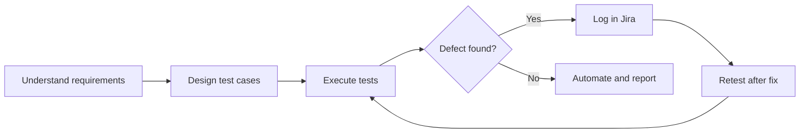

<h1 align="center">Hi 👋, I'm Venkata Chandu Pitta</h1>

<p align="center">
  <a href="https://github.com/venkatachandu1011">
    
  </a>
</p>

<p align="center">
  <a href="https://venkatachandu1011.github.io/Venkata_Chandu/"></a>
  <a href="https://www.linkedin.com/in/venkata-chandu-ba3686253/"></a>
  <a href="mailto:venkata111chandu@gmail.com"></a>
</p>

---

## 🐞 Open Bug Report

| Field | Details |
|---|---|
| **Bug ID** | `BUG-001` |
| **Summary** | Your team is missing a detail-oriented QA Engineer |
| **Severity** | High: bugs may reach production |
| **Steps to reproduce** | Ship features without a tester |
| **Expected result** | Defects caught before release |
| **Assigned to** | **Venkata Chandu Pitta** |
| **Status** | 🟢 Ready to fix: available for a Software Test Engineer / QA Engineer role |

---

## 👨‍💻 About Me

- 🎓 2026 B.Tech CSE graduate, Lovely Professional University
- 🧑‍💻 Software Testing Trainee at **QEdge Technologies**, Hyderabad
- 🔍 I design test cases, run functional and regression tests, and log defects in **Jira**
- 🤖 I automate web UI with **Java, Selenium WebDriver, TestNG, Maven and the Page Object Model**
- 🔌 I test REST APIs in **Postman** and verify data with **SQL and PostgreSQL**

---

## 🧬 My Profile as a Test Class

```java
public class VenkataChandu extends QAEngineer {

    String role       = "Software Test Engineer";
    String[] manual   = {"Test Cases", "Functional", "Regression", "Smoke", "Sanity", "RTM"};
    String[] automate = {"Java", "Selenium WebDriver", "TestNG", "Maven", "POM"};
    String[] api      = {"Postman", "REST", "JSON", "Status Codes"};
    String[] data     = {"SQL", "PostgreSQL", "Data Validation"};
    String[] tools    = {"Jira", "Git", "GitHub", "IntelliJ IDEA", "Agile", "Scrum"};

    @Test
    public void shouldBeHired() {
        Assert.assertTrue(skills.areReady());
        Assert.assertEquals(attitude, "always testing beyond the happy path");
    }
}
```

---

## 🔄 How I Work



---

## 🧪 Latest Test Run

| Test | Result |
|---|---|
| Manual testing: SDLC, STLC, test design | ✅ Passed |
| UI automation: Selenium, TestNG, POM | ✅ Passed |
| API testing: Postman, REST, negative cases | ✅ Passed |
| Database validation: SQL, PostgreSQL | ✅ Passed |
| Defect tracking: Jira, defect life cycle | ✅ Passed |
| Learning mindset | 🔄 Always running |

---

## 🛠️ Tech Stack


---

## 📌 Featured Projects

| Project | What I tested | Tech |
|---|---|---|
| 🔌 [**CollabConnect**](https://github.com/venkatachandu1011/CollabConnect) | 40+ API scenarios: authentication, search, CRUD, negative cases, SQL data checks | Java, Postman, PostgreSQL |
| 🛒 **E-Commerce Web App** | 60+ test cases with RTM, 15+ automated regression scenarios, 20+ defects tracked in Jira | Selenium, TestNG, Maven |
| 🌐 [**QA Portfolio Website**](https://venkatachandu1011.github.io/Venkata_Chandu/) | Responsive site with dark/light theme, hosted on GitHub Pages | HTML, CSS, JS |

---

## 📜 Certifications

- 🏅 Oracle Certified Foundations Associate (Apr 2026)
- ☕ Java Masterclass, 130+ hours, Udemy (Mar 2026)

---

## 📊 GitHub Stats

<p align="center">
  
  
</p>

---

## 🚀 Let's Connect & Collaborate!

💡 Open to **Software Test Engineer / QA Engineer** roles, internships and chats with fellow testers about **automation, API testing and quality**.

📩 [venkata111chandu@gmail.com](mailto:venkata111chandu@gmail.com) · 💼 [LinkedIn](https://www.linkedin.com/in/venkata-chandu-ba3686253/) · 🌐 [Portfolio](https://venkatachandu1011.github.io/Venkata_Chandu/)

<p align="center"><i>"Quality is not an act, it is a habit."</i></p>
